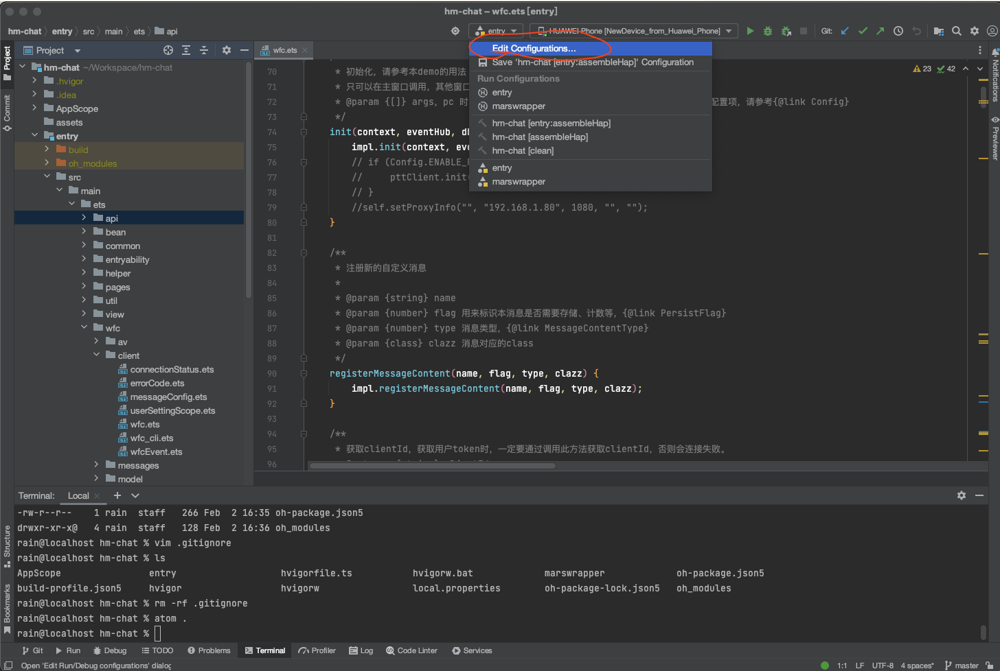
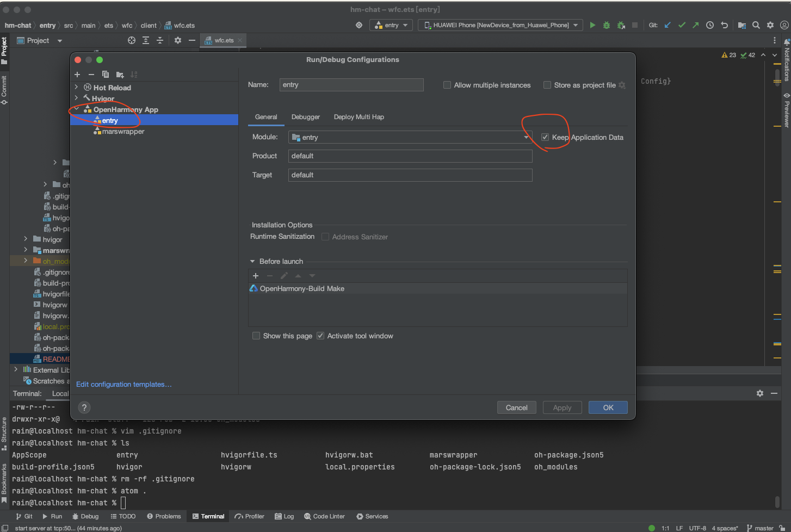
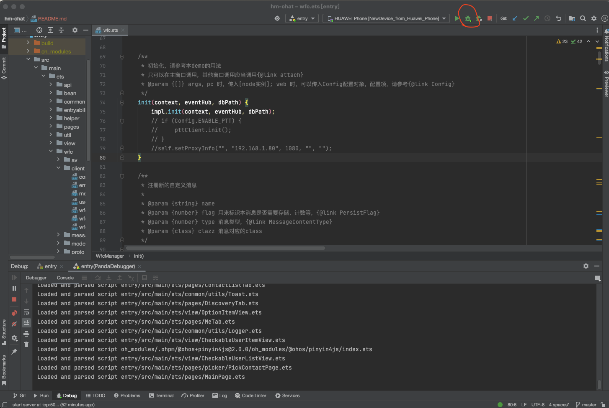

## 野火IM鸿蒙原生平台，支持手机和 Pad

野火IM是专业级即时通讯和实时音视频整体解决方案，由北京野火无限网络科技有限公司维护和支持。

主要特性有：私有部署安全可靠，性能强大，功能齐全，全平台支持，开源率高，部署运维简单，二次开发友好，方便与第三方系统对接或者嵌入现有系统中。详细情况请参考[在线文档](https://docs.wildfirechat.cn)。

主要包括一下项目：

| [GitHub仓库地址(主站)](https://github.com/wildfirechat)            | [码云仓库地址(镜像)](https://gitee.com/wfchat)                | 说明                                                             | 备注                      |
|--------------------------------------------------------------|-------------------------------------------------------|----------------------------------------------------------------|-------------------------|
| [im-server](https://github.com/wildfirechat/im-server)       | [im-server](https://gitee.com/wfchat/im-server)       | IM Server                                                      |                         |
| [android-chat](https://github.com/wildfirechat/android-chat) | [android-chat](https://gitee.com/wfchat/android-chat) | 野火IM Android SDK源码和App源码                                       | 可以很方便地进行二次开发，或集成到现有应用当中 |
| [ios-chat](https://github.com/wildfirechat/ios-chat)         | [ios-chat](https://gitee.com/wfchat/ios-chat)         | 野火IM iOS SDK源码和App源码                                           | 可以很方便地进行二次开发，或集成到现有应用当中 |
| [pc-chat](https://github.com/wildfirechat/vue-pc-chat)       | [pc-chat](https://gitee.com/wfchat/vue-pc-chat)       | 基于[Electron](https://electronjs.org/)开发的PC 端                   |                         |
| [web-chat](https://github.com/wildfirechat/vue-chat)         | [web-chat](https://gitee.com/wfchat/vue-chat)         | 野火IM Web 端, [体验地址](http://web.wildfirechat.cn)                 |                         |
| [wx-chat](https://github.com/wildfirechat/wx-chat)           | [wx-chat](https://gitee.com/wfchat/wx-chat)           | 小程序平台的Demo(支持微信、百度、阿里、字节、QQ 等小程序平台)                            |                         |
| [app server](https://github.com/wildfirechat/app_server)     | [app server](https://gitee.com/wfchat/app_server)     | 应用服务端                                                          |                         |
| [robot_server](https://github.com/wildfirechat/robot_server) | [robot_server](https://gitee.com/wfchat/robot_server) | 机器人服务端                                                         |                         |
| [push_server](https://github.com/wildfirechat/push_server)   | [push_server](https://gitee.com/wfchat/push_server)   | 推送服务器                                                          |                         |
| [docs](https://github.com/wildfirechat/docs)                 | [docs](https://gitee.com/wfchat/docs)                 | 野火IM相关文档，包含设计、概念、开发、使用说明，[在线查看](https://docs.wildfirechat.cn/) |                         |

野火IM 鸿蒙原生平台 Demo，演示如何将野火IM的能力集成到鸿蒙原生平台中。

## 前置说明

1. 本项目所使用的`libmarswrapper.so`（打包在`client/libs/marswrapper.har`中）是需要付费的，价格请参考[费用详情](https://docs.wildfirechat.cn/price/)
2. `libmarswrapper.so`支持试用，具体请看[试用说明](https://docs.wildfirechat.cn/trial/)
3. 本项目默认只能连接到官方服务，购买或申请试用之后，替换`client/libs/marswrapper.har`，即可连到自行部署的服务。替换方法见[client/libs/README.md](client/libs/README.md)

## 环境依赖
鸿蒙集成开发环境```DevEco-Studio```。可以创建和编译鸿蒙原生项目。

## 开发
使用```DevEco-Studio```打开本项目，运行之前海需要修改一下项目配置:
1. 打开项目运行配置

2. 打开保持应用数据

3. 运行


## 常见问题
1. 找不到`@wfc/avengineki` 或 `@wfc/client`，导致有非常多的编译错误。
    解决办法：到项目根目录下执行`ohpm install`。
2. 替换`marswrapper.har`不生效。
    原因：该依赖是`file:`本地依赖且版本号固定为`1.0.0`，ohpm 会把 har 安装到`oh_modules/.ohpm`缓存中，仅替换文件不会触发重新安装。
    解决办法：删除各模块的`oh_modules`目录和根目录的`oh_modules/.ohpm`缓存，重新执行`ohpm install`（或在 DevEco Studio 中执行 File -> Sync and Refresh Project），再重新编译。详细步骤见[client/libs/README.md](client/libs/README.md)。

## 注意事项
1. 野火IM要求客户端和服务器之间的时间差不能太大，有时模拟器的时间会不准，导致无法正常工作。所以必须确保手机或者模拟器时间准确。

## 自签证书说明
自建服务（IM 服务、应用服务、组织通讯录、对象存储等）使用自签名证书时，按以下步骤配置：

1. **放置证书**：将证书放到`chat/src/main/resources/resfile`目录，可以放多个，文件名不限，后缀为`.crt`、`.pem`或`.cer`，如`server.crt`
   - 放 CA 证书或服务端证书本身均可，只放证书，**不要放私钥**
   - 必须是 PEM 格式，即以`-----BEGIN CERTIFICATE-----`开头的文本文件。DER 格式的证书请先转换：`openssl x509 -inform der -in server.der -out server.crt`
   - 上层网络请求（应用服务、组织通讯录、投票、接龙、归档、语音识别、文件上传下载、工作台等 WebView）启动时自动加载这个目录下的证书（见`EntryAbility`中的`selfSignedCertUtils.init`），没有证书时全部使用系统默认配置
   - `Image`、`Video`组件自己加载网络资源时不认应用内置的证书（`network_config.json`的`trust-anchors`对它们也不生效），头像、聊天图片、表情、预览中的图片和视频、朋友圈、收藏等处已改为先下载到缓存目录再显示，即`Image(trustedMediaSrc(url))`。新增显示网络图片、视频的地方也要这样处理

2. **协议栈**：IM 连接要使用 TLS 时，需要打开`EntryAbility#onCreate`中被注释的`wfc.UseTls`代码，仅 2026.9.11 之后的 IM 服务支持。证书路径用`this.context.resourceDir + '/证书文件名'`

3. **以 SDK 方式集成时**：调用`selfSignedCertUtils.init(context, 证书目录)`加载证书，自己创建的网络请求通过`selfSignedCertUtils`信任这些证书：
   - Network Kit 的`http`、`webSocket`：请求参数中带上`caPath: selfSignedCertUtils.getCaPath()`
   - RCP：`security.remoteValidation`设置为`{ filePath: selfSignedCertUtils.getCaPath() }`
   - 系统上传下载服务（`request.uploadFile`、`request.downloadFile`）不认应用内置的证书，下载改用`selfSignedCertUtils.download`，参考`mediaHelper.ets`中的`downloadMedia`。SDK 的大文件上传已经处理
   - Web 组件：在`onSslErrorEventReceive`中，`selfSignedCertUtils.isTrustedBySelfSignedCerts(event.certChainData)`返回`true`时才调用`handler.handleConfirm()`，否则调用`handler.handleCancel()`，参考`WfcWebView.ets`
   - `Image`、`Video`组件：`Image(trustedMediaSrc(url))`，有自签名证书时先下载再显示，下载完成后组件自动刷新

4. **注意事项**
   - `getCaPath()`返回的证书文件中同时包含系统预置的 CA 证书和自签名证书，公网 CA 签发的证书不受影响
   - 和 Android 不同，鸿蒙上的网络请求**不会**跳过域名校验，签发证书时必须把服务的域名和 IP 都写进 subjectAltName，否则会校验失败
   - Web 组件和 Android 一样不校验域名，且只检查服务端证书本身，所以只支持服务端证书就是`resfile`中的证书，或者由其直接签发的情况；需要 API 15 及以上，更低版本的设备按默认处理（取消加载）

## 截图


## License

1. Under the Creative Commons Attribution-NoDerivs 3.0 Unported license. See the [LICENSE](https://github.com/wildfirechat/vue-chat/blob/master/LICENSE) file for details.
